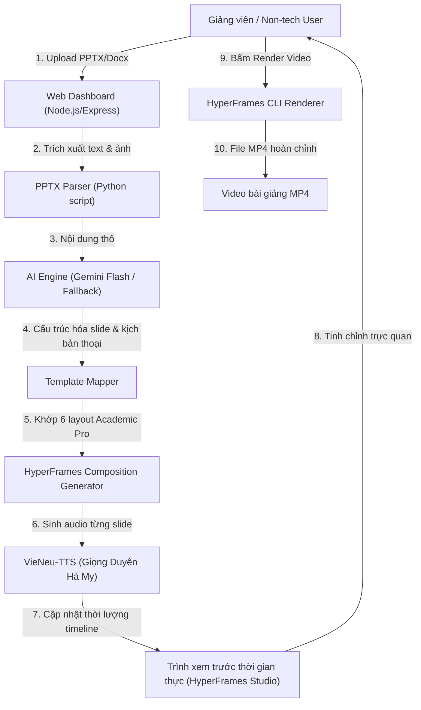

# Kiến Trúc Hệ Thống: HyperFrames Lecture Studio
> **Giải pháp tự động chuyển đổi tài liệu bài giảng (PPTX / Word) thành video bài giảng HyperFrames tương tác cao với giọng đọc thuyết minh VieNeu-TTS dành cho người dùng non-tech.**

---

## 1. Tổng quan Kiến trúc (High-Level Architecture)



---

## 2. Các Thành phần Cốt lõi (Core Components)

### 2.1. Thư viện 6 Layout Template Học thuật Chuẩn mực (Academic Pro)
Được cấu trúc thành các **Sub-compositions** độc lập trong thư mục `templates/` hoặc `compositions/`, cho phép lắp ráp linh hoạt vào `index.html`:

| STT | Tên Layout | Bố cục Visual | Mục đích sử dụng |
| :--- | :--- | :--- | :--- |
| **01** | `hero-title` | Tiêu đề lớn, meta badge, 3 thẻ mục tiêu bài học + tranh minh họa | Slide mở đầu bài giảng, giới thiệu chương / bài học |
| **02** | `two-column-concept` | Cột trái: định nghĩa + gạch đầu dòng cốt lõi; Cột phải: tranh minh họa bo góc viền kính | Trình bày một khái niệm, quy luật hoặc định nghĩa trọng tâm |
| **03** | `three-pillars` | 3 thẻ dọc/ngang với số thứ tự phát sáng, tiêu đề phụ và nội dung chi tiết | Phân tích 3 nguồn gốc, 3 đặc điểm, 3 điều kiện hoặc 3 bộ phận cấu thành |
| **04** | `timeline-history` | Trục thời gian ngang hoặc dọc với các mốc năm/giai đoạn phát triển | Trình bày bối cảnh lịch sử, quá trình hình thành & phát triển tư tưởng |
| **05** | `comparison-grid` | 2 cột so sánh trực diện (Luận điểm vs Phản đề, Duy vật vs Duy tâm) | Làm rõ sự khác biệt giữa hai trường phái, quan điểm hoặc hiện tượng |
| **06** | `summary-takeaways` | Thẻ tổng kết lớn, 3 gạch đầu dòng ghi nhớ chính + câu hỏi thảo luận | Slide kết bài, đúc kết bài học thực tiễn |

---

## 2.2. Luồng Xử lý Dữ liệu Tự động (Pipeline)

1. **Upload & Extraction**:
   - Nhận file PPTX, bóc tách toàn bộ slide: tiêu đề, đoạn văn, bullet points, ghi chú giảng viên (notes), và hình ảnh minh họa nhúng trong slide.
2. **AI Structuring (Gemini Flash)**:
   - Gửi nội dung thô qua Gemini Flash để rút gọn văn bản thành ý cốt lõi, chọn layout phù hợp nhất trong 6 layout trên, và viết kịch bản thoại thuyết minh tự nhiên (giọng giảng bài chuẩn sư phạm).
   - *Fallback thông minh*: Nếu không có API Key, hệ thống tự động ánh xạ tiêu đề và các gạch đầu dòng trực tiếp vào template phù hợp theo quy tắc số lượng bullet points.
3. **VieNeu-TTS Generation & Timeline Calculation**:
   - Gọi mô hình VieNeu-TTS sinh file WAV/MP3 cho từng slide.
   - Đo thời lượng chính xác của file âm thanh (ví dụ: Slide 1 = 18.5s).
   - Tự động gán `data-start` và `data-duration` tương ứng cho từng slide trong `index.html`, đảm bảo chuyển động GSAP khớp nhịp 100% với giọng nói.

---

## 2.3. Giao diện Web Dashboard (Split Screen View)

```
+---------------------------------------------------------------------------------------+
|  🎓 HyperFrames Lecture Studio                                [ Nhập API Key ] [ Help ]|
+---------------------------------------------------------------------------------------+
|  [ Kéo thả file PPTX vào đây để tạo bài giảng mới ]                                   |
+---------------------------------------------------+-----------------------------------+
|  DANH SÁCH SLIDE (BÊN TRÁI)                       |  XEM TRƯỚC BÀI GIẢNG (BÊN PHẢI)   |
|                                                   |                                   |
|  [Slide 1] [Layout: Hero Title ▼]                 |  +-----------------------------+  |
|  Tiêu đề: Triết học và Triết học Mác - Lênin      |  |                             |  |
|  Lời thoại: "Chào mừng các bạn đến với..."        |  |     HyperFrames Player      |  |
|  [ Nghe thử ] [ Thay ảnh ] [ Xóa ]                |  |                             |  |
|                                                   |  +-----------------------------+  |
|  [Slide 2] [Layout: Two Column Concept ▼]         |  Timeline: 01:35 / 03:20          |
|  Tiêu đề: Định nghĩa Triết học                    |  [ ▶ Play ] [ ❚❚ Pause ] [ ↻ ]    |
|  Nội dung: Hệ thống tri thức lý luận chung nhất...|                                   |
|  [ Nghe thử ] [ Thay ảnh ]                        |  -------------------------------  |
|                                                   |  TIẾN TRÌNH XUẤT VIDEO:           |
|  [Slide 3] [Layout: Three Pillars ▼]              |  [ 🎬 Xuất Video MP4 ]             |
|  ...                                              |  Tiến độ: [██████████░░░] 75%     |
+---------------------------------------------------+-----------------------------------+
```

- **Sửa tức thì (Granular Regeneration)**: Khi sửa lời thoại ở Slide 2, hệ thống chỉ chạy lại VieNeu-TTS cho Slide 2, tự động dịch chuyển timeline các slide 3, 4, 5 phía sau mà không phải render lại toàn bộ từ đầu.

---

## 3. Lộ trình Triển khai Kỹ thuật (Implementation Roadmap)

- [ ] **Giai đoạn 1: Chuẩn hóa 6 Layout Templates**
  - Tách các layout của Slide 1, 2, 3, 4, 5, 6 thành các mẫu chuẩn với placeholder rõ ràng (`{{title}}`, `{{points}}`, `{{image}}`, `{{speech}}`).
- [ ] **Giai đoạn 2: Parser & Script Trích xuất PPTX**
  - Viết module Python `extract_pptx.py` trích xuất text, notes và hình ảnh từ file `.pptx` người dùng tải lên.
- [ ] **Giai đoạn 3: Tích hợp Gemini AI & Pipeline Sinh HyperFrames**
  - Viết script `generate_lecture.js` nhận dữ liệu phân tích, gọi VieNeu-TTS sinh âm thanh, ráp vào template và tạo ra thư mục bài giảng.
- [ ] **Giai đoạn 4: Xây dựng Giao diện Web Dashboard (Node.js/Express)**
  - Giao diện 2 cột tinh gọn, hỗ trợ upload kéo thả, xem danh sách slide, sửa văn bản, đổi template dropdown, và nhúng iframe HyperFrames Studio.
- [ ] **Giai đoạn 5: Tích hợp nút Render & Tải về MP4**
  - Tích hợp gọi `npx hyperframes render` từ giao diện web, hiển thị thanh tiến trình render và nút tải file MP4 trực tiếp về máy.
