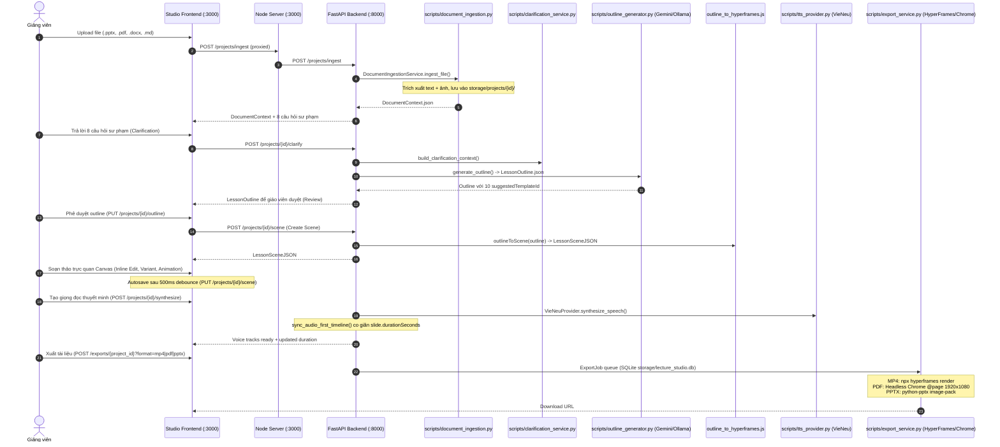

# Báo Cáo Hiện Trạng Hệ Thống (AS-IS MAP) — AI Lecture Studio v1

**Thời điểm phân tích:** 2026-10-20  
**Tác giả:** Explore Audit Agent  
**Mục tiêu:** Cung cấp bản đồ hiện trạng chi tiết, khách quan về luồng dữ liệu, các điểm phụ thuộc `templateId`, nguyên nhân lỗi 404/slide trắng, và các thành phần cần giữ nguyên vs thay đổi khi chuyển sang kiến trúc Template-First v2.

---

## 1. Luồng Dữ Liệu Từ Upload Đến Export (Data Flow)

Kiến trúc hiện tại là mô hình **Dual Service**:
- **FastAPI Backend (:8000)** (`server/api_service.py`): Tiếp nhận file, ingestion tài liệu, LLM outline, VieNeu-TTS, và export pipeline.
- **Node.js Gateway / Studio (:3000)** (`server.js` + `studio.html`): Phục vụ frontend Studio, reverse-proxy các request `/projects`, `/exports`, `/storage` về cổng 8000, và quản lý live preview HyperFrames.

### Chi tiết các hàm cốt lõi theo file:
1. **Document Ingestion**:
   - `scripts/document_ingestion.py`:`DocumentIngestionService.ingest_file(file_path, project_id)`
   - Trích xuất ảnh PPTX từ `ppt/media/*` lưu vào `storage/projects/{project_id}/images/{filename}` với URL dạng `storage/projects/{project_id}/images/{filename}`.
2. **Clarification & Dàn ý**:
   - `scripts/clarification_service.py`:`ClarificationService.generate_questions()` & `build_clarification_prompt()`
   - `scripts/outline_generator.py`:`OutlineGenerator.generate()` gọi `LLMProvider.generate_structured()` trả về `LessonOutline`.
3. **Mapper & HyperFrames Composition**:
   - `outline_to_hyperframes.js`:`outlineToScene(outline)` ánh xạ outline thành `LessonSceneJSON`.
   - `outline_to_hyperframes.js`:`sceneToHyperFramesHtml(scene)` dịch `LessonSceneJSON` thành `index.html` (chứa GSAP timeline, audio cues, subtitle bar `#vVoiceText`).
4. **Studio & Trạng thái Editor**:
   - `studio/reducer.js`:`lectureReducer(state, action)` quản lý cập nhật bất biến, kiểm định schema với `ALLOWED_TEMPLATES`, `computeSlideDuration()`.
   - `studio.html` (và `index.html`): Lắng nghe `input`, `blur`, cập nhật DOM, gửi PUT `/projects/{id}/scene` sau debounce 500ms.
5. **TTS & Audio-First Sync**:
   - `scripts/tts_provider.py`:`VieNeuProvider.synthesize(text, output_path)` sinh file `.wav`.
   - `server/api_service.py`:`sync_audio_first_timeline()`: tính `slide.durationSeconds = max(audio_duration + 0.8s, min_anim, 3.0s)` và dịch chuyển mốc thời gian tuần tự.
6. **Multi-Format Export Pipeline**:
   - `scripts/export_service.py`:`ExportService.export_mp4()`: gọi `npx hyperframes render index.html -o renders/presentation.mp4`.
   - `ExportService.export_pdf()`: dùng Playwright / Headless Chrome in vector PDF theo trang 16:9 (`1920x1080`).
   - `ExportService.export_pptx()`: dùng `python-pptx` đóng gói screenshot 1080p + speaker notes.

---

## 2. Nơi Định Nghĩa 10 Templates Hiện Tại

Toàn bộ 10 template hiện tại được định nghĩa và phân bổ cứng tại 4 vị trí:

1. **Giao diện & Layout CSS**: `templates/templates.css`
   - `.hf-template-title-slide`
   - `.hf-template-learning-objectives`
   - `.hf-template-concept-explain`
   - `.hf-template-bullet-breakdown`
   - `.hf-template-image-explain`
   - `.hf-template-comparison`
   - `.hf-template-timeline`
   - `.hf-template-formula-explain`
   - `.hf-template-quiz`
   - `.hf-template-summary`
2. **Renderers HTML & Metadata Registry**: `templates/index.js`
   - Object `TEMPLATES`: chứa `name`, `description`, `icon`, `suggestedDuration`, `slots`, `defaultVariant`, `allowedVariants`.
   - Hàm `renderSlide(slide, index, startTime)`: render switch-case tương ứng cho từng template.
3. **Logic Ánh Xạ Phần Tử (Elements Mapper)**: `outline_to_hyperframes.js`
   - Mảng `VALID_TEMPLATES`.
   - Hàm `buildElementsForTemplate(templateId, slide)`: switch-case tạo các phần tử (`badge`, `text`, `image`, `bullet-list`, `card`, `timeline-step`, `formula`, `quiz-block`).
   - Hàm `buildDefaultAnimations(templateId, elements)`.
4. **Trình Quản Lý Biên Tập State**: `studio/reducer.js`
   - Mảng `ALLOWED_TEMPLATES` dùng để validate mỗi khi có action cập nhật hoặc đổi layout.

---

## 3. Danh Sách Mọi Vị Trí Tham Chiếu `templateId`

Khi thực hiện migration sang mô hình `packId` + `layoutId`, các file và vị trí sau sẽ bị ảnh hưởng trực tiếp:

1. **Schemas & Models**:
   - `schemas/lesson_outline.json`: định nghĩa enum `suggestedTemplateId`.
   - `schemas/lesson_scene.json`: định nghĩa enum `templateId`.
   - `schemas/models.py`: Enum `TemplateId` và trường `SlideScene.templateId`.
   - `schemas/types.ts`: Enum `TemplateIdEnum` và `SceneSlideSchema.shape.templateId`.
2. **Pipeline & Ingestion / Outline**:
   - `scripts/outline_generator.py`: Gán `suggestedTemplateId` từ dàn bài AI.
3. **Engine & Mapping**:
   - `outline_to_hyperframes.js`: `VALID_TEMPLATES`, `validateScene()`, `outlineToScene()`, `buildElementsForTemplate()`, `buildDefaultAnimations()`.
   - `templates/index.js`: `TEMPLATES[slide.templateId]`, class `.hf-template-${slide.templateId}`.
4. **Studio Frontend**:
   - `studio.html` & `studio/index.html`: `s.templateId`, badge hiển thị, dropdown select `#templateSelect`, các action dispatch `UPDATE_SLIDE_FIELD` với `templateId`.
   - `studio/reducer.js` & `reducer.js`: `ALLOWED_TEMPLATES`, kiểm tra `slide.templateId`.
5. **Export & Reports**:
   - `scripts/export_service.py`: Hiển thị badge `Slide {idx + 1} • {slide.templateId}` trên slide PDF và speaker notes PPTX.
6. **Bộ Kiểm Thử (Tests)**:
   - `tests/test_contracts.py`: Kiểm tra đồng bộ enum giữa JSON Schema và Pydantic/Zod.
   - `tests/engine/test_mapper.py`: Kiểm tra validation `templateId`.
   - `tests/engine/test_engine.py`: Kiểm tra danh sách templates trong scene.
   - `tests/engine/test_templates_snapshot.py`: Snapshot kiểm thử hiển thị của 10 template.
   - `tests/engine/test_studio_reducer.py`: Test reject `templateId` không hợp lệ.
   - `tests/pipeline/test_export.py` & `tests/pipeline/test_audio_sync.py`: Dữ liệu mẫu dùng `templateId`.

---

## 4. Tái Hiện & Báo Cáo Nguyên Nhân Gốc (Root Cause)

### 4.1. Lỗi 404 trong Console (`docs/qa/report.json`)
- **Triệu chứng:** QA báo cáo lỗi `[error] Failed to load resource: the server responded with a status of 404 (Not Found)`.
- **Nguyên nhân gốc 1 (Reverse Proxy & FastAPI route):**
  - Trong `server.js`, mọi URL bắt đầu bằng `/storage` được proxy thẳng về `http://localhost:8000/storage/...`.
  - Nhưng trong `server/api_service.py`, FastAPI chỉ đăng ký route:
    `@app.get("/storage/projects/{project_id}/audio/{filename}")`
    mà **hoàn toàn không có route static** phục vụ thư mục `/storage/projects/{project_id}/images/{filename}`!
  - Khi trình duyệt tải ảnh từ URL do hệ thống tạo ra, FastAPI lập tức trả về `404 Not Found`.
- **Nguyên nhân gốc 2 (Fallback URL không tồn tại):**
  - Trong `outline_to_hyperframes.js` (dòng 478, 489, 501), các template `title-slide`, `concept-explain`, `image-explain` có fallback cứng:
    `'storage/projects/sample/images/philosophy_intro.png'`
  - Thư mục `storage/projects/sample/` **không hề tồn tại** trên ổ đĩa. Bất kỳ slide nào không nhận được ảnh đều trỏ về file ma này và gây 404.

### 4.2. Hiện tượng Slide Trắng & Hiếm Khi Có Ảnh
- **Triệu chứng:** Slide sinh ra thường trống trải, ít chữ và gần như không bao giờ có ảnh từ tài liệu.
- **Nguyên nhân gốc:**
  - `DocumentIngestionService` (`scripts/document_ingestion.py`) đã bóc tách ảnh và gắn vào `DocumentContext.extractedImages` + `section.imageIds`.
  - **Tuy nhiên**, `scripts/outline_generator.py` khi nhận `DocumentContext` để tạo prompt cho Gemini đã **bỏ qua hoàn toàn** thông tin `extractedImages` và `imageIds`! Prompt gửi tới LLM không chứa danh sách ảnh sẵn có.
  - Kết quả: `LessonOutline` trả về không có thông tin ảnh (`payload.image` luôn `undefined`).
  - Khi `outline_to_hyperframes.js` nhận outline, nó không có ảnh để gán vào `elements[]`, và layout rơi vào trạng thái thiếu vắng nội dung thị giác (dẫn đến slide trắng hoặc trống trải).

---

## 5. Đánh Giá Khả Năng Render Video Của HyperFrames

Qua việc tra cứu tài liệu và CLI HyperFrames (`npx hyperframes docs rendering` và `data-attributes`):
- **Khẳng định:** HyperFrames **có hỗ trợ đầy đủ** render `<video>` nhúng cục bộ:
  - Hỗ trợ `--video-frame-format auto|jpg|png` để trích xuất từng khung hình của source video khi render MP4.
  - Hỗ trợ các thuộc tính timing và media: `data-start`, `data-duration`, `data-media-start` (trim điểm đầu), `data-volume` (gain âm thanh), `data-fade-in`, `data-fade-out`.
  - Quy tắc âm thanh: `<video data-has-audio="true">` giữ âm thanh gốc của clip; nếu là clip b-roll/minh họa không tiếng thì dùng thuộc tính `muted`.
  - Điều này giải tỏa rủi ro lớn nhất: **HyperFrames hoàn toàn có thể render video nhúng trong slide sang MP4 mà không cần viết tool mux FFmpeg ngoài lề**.

---

## 6. Tổng Kết: Thành Phần Giữ Nguyên vs Thay Đổi Cho v2

### Giữ nguyên (Tuyệt đối không đụng vào):
1. **Audio-First Sync Engine**: Hàm tính `durationSeconds = max(audio + 0.8s, anim)` và tịnh tiến timeline trong `server/api_service.py` và `outline_to_hyperframes.js`.
2. **Export Pipeline**: Cơ chế queue job trong SQLite, render MP4 qua `npx hyperframes render`, in PDF vector qua Chrome, và xuất PPTX.
3. **Studio Canvas Core & Autosave**: Cơ chế Reducer, debounce autosave 500ms, Undo/Redo, và inline text editing (`contenteditable`).
4. **VieNeu-TTS & Providers Interface**: `TTSProvider` và `LLMProvider` (Gemini Flash + Ollama adapter).

### Phải thay đổi cho Target v2 (Template-First):
1. **Thêm Thư Viện Template Pack**: Thay vì 10 template rời rạc, gói 10 template hiện tại thành **Template Pack "Basic"**. Bổ sung Template Registry tải động từ filesystem.
2. **Nâng cấp Schema từ v1 sang v2**:
   - Project: thêm `packId: string`, `schemaVersion: 2`.
   - Slide: thay `templateId` -> `layoutId`, thay `elements[]` tự do -> `slotValues: Record<string, any>` + `elements[]` cho decor/phần tử tự thêm.
   - Viết module `migrate_v1_to_v2()` để các project v1 cũ vẫn mở và render chuẩn xác.
3. **Sửa dứt điểm lỗi 404 & Phục vụ Ảnh**:
   - FastAPI mount static route cho `/storage/projects/{project_id}/images/`.
   - Node `server.js` cấu hình phục vụ static đúng đắn.
   - Xóa bỏ fallback trỏ tới file ảo `sample/images/philosophy_intro.png`.
4. **Đổi thứ tự luồng người dùng (User Flow)**:
   - Bước 1: Mở **Template Gallery** (browse/filter theo chủ đề, phong cách, hiệu ứng) -> chọn Pack.
   - Bước 2: Nạp tài liệu (upload / paste).
   - Bước 3: **Slot Filler + Clarification thích ứng**: Chỉ hỏi những câu chưa tự suy diễn được từ nội dung tài liệu.
5. **Media Recommender**:
   - Phân tích `visual_need` trên từng slide.
   - Gợi ý ảnh trích xuất từ tài liệu thật, sơ đồ SVG/Mermaid, hoặc video clip ngắn.
6. **Template Builder (Giai đoạn P5)**:
   - Tái sử dụng Canvas Studio để cho phép kéo thả, gán Slot, variant và lưu thành Layout mới vào Pack.
