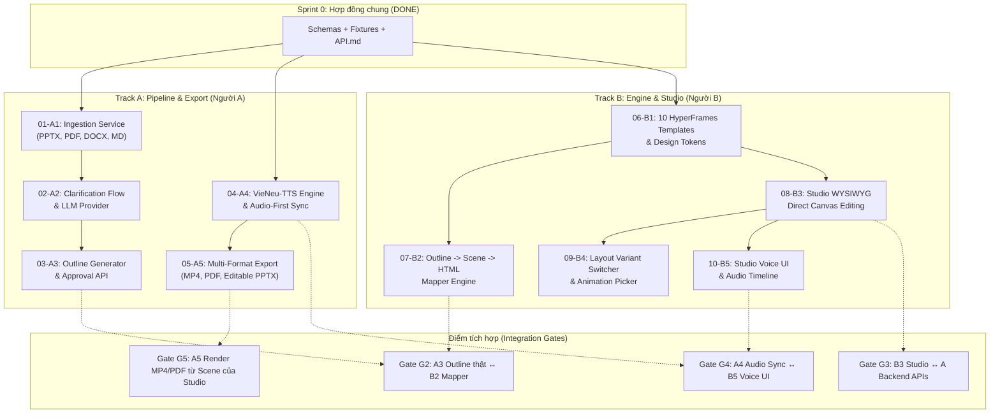

# AI Lecture Studio — Work Breakdown Tickets (Tracer Bullets)

> **Sprint 0 Frozen Contracts**: [schemas/](file:///c:/Users/OS/Downloads/project/my-presentation/schemas), [fixtures/](file:///c:/Users/OS/Downloads/project/my-presentation/fixtures), [docs/API.md](file:///c:/Users/OS/Downloads/project/my-presentation/docs/API.md).  
> **Rule**: Hai người làm việc song song trong worktree riêng. Chỉ giao tiếp qua shared contracts và mock fixtures.

---

## Dependency Graph (Sơ đồ phụ thuộc)

---

## Chi Tiết Các Tracer-Bullet Tickets

| ID | Thẻ | Tiêu đề | Phụ thuộc (Blocked by) | Trạng thái |
| :--- | :--- | :--- | :--- | :--- |
| **01** | `[A]` | Multi-format Document Ingestion Service | Không (Schema frozen) | `completed` |
| **02** | `[A]` | Clarification Interview & LLM Provider Setup | `01-A1` (Done) | `completed` |
| **03** | `[A]` | Pedagogical Outline Generator & Approval API | `02-A2` (Done) | `completed` |
| **04** | `[A]` | VieNeu-TTS Synthesis & Audio-First Sync Engine | Không (Done) | `completed` |
| **05** | `[A]` | Multi-format Export Jobs (MP4, PDF, PPTX) | `04-A4` (Done) | `completed` |
| **06** | `[B]` | Design Tokens & 10 HyperFrames Templates | Không (dùng `fixtures/scene.sample.json`) | `completed` |
| **07** | `[B]` | Outline to Scene & HyperFrames Mapper | `06-B1` (dùng `fixtures/outline.sample.json`) | `completed` |
| **08** | `[B]` | Studio Canvas Direct Editing & Autosave | `06-B1` | `completed` |
| **09** | `[B]` | Layout Variant Switcher & Animation Picker | `08-B3` | `completed` |
| **10** | `[B]` | Studio Voice UI & Audio-Driven Timeline | `08-B3` | `completed` |

---

## AI Lecture Studio v2 — Work Breakdown Tickets (P1 -> P7)

| Ticket ID | Tag | Phase | Tiêu đề | Phụ thuộc | Trạng thái |
| :--- | :--- | :--- | :--- | :--- | :--- |
| **P1.1** | `[A]` | P1 | Sửa lỗi 404 static images trong FastAPI + Node proxy & xóa fallback ảo | Không | `completed` |
| **P1.2** | `[A]` | P1 | Cập nhật JSON Schema v2, Pydantic & TS models (TemplatePack, Slot, SlideSceneV2) | Không | `completed` |
| **P1.3** | `[A]` | P1 | Viết migration `migrate_v1_to_v2` (in-memory + CLI) & snapshot tests | `P1.2` | `completed` |
| **P1.4** | `[B]` | P1 | Đóng gói 10 layout hiện tại thành Template Pack mặc định "Basic" | `P1.2` | `completed` |
| **P1.5** | `[B]` | P1 | Xây dựng `TemplateRegistry` nạp và validate packs từ filesystem | `P1.4` | `completed` |
| **P2.1** | `[B]` | P2 | Prototype nhanh Template Gallery (bộ lọc subject, style, effect) | `P1.5` | `completed` |
| **P2.2** | `[A]` | P2 | API `GET /packs` (filters) & `GET /packs/{id}` & `POST /packs` | `P1.5` | `completed` |
| **P2.3** | `[B]` | P2 | Tích hợp Gallery vào Studio làm bước 1 & chuyển đổi luồng tạo project | `P2.1`, `P2.2` | `completed` |
| **P3.1** | `[A]` | P3 | `AdaptiveClarificationService` (suy diễn thông minh từ doc & pack) | `P2.3` | `completed` |
| **P3.2** | `[A]` | P3 | `SlotFillerEngine` điền slot với LLM + auto-retry tóm tắt khi tràn slot | `P1.2` | `completed` |
| **P3.3** | `[B]` | P3 | UI Studio duyệt dàn bài & nạp nội dung theo slot chuẩn | `P3.1`, `P3.2` | `completed` |
| **P4.1** | `[A]` | P4 | Module phân tích nhu cầu thị giác `visual_need` theo từng slide | `P3.2` | `completed` |
| **P4.2** | `[A]` | P4 | 3 MediaSource adapters: DocumentImage, Diagram SVG/Mermaid/Chart, Upload | `P4.1` | `completed` |
| **P4.3** | `[B]` | P4 | Media Strip UI: gợi ý 3-4 ứng viên 1-chạm & variant fallback khi không có ảnh | `P4.2` | `completed` |
| **P5.1** | `[B]` | P5 | Template Builder: kéo thả khối trên Canvas Studio | `P1.5` | `pending` |
| **P5.2** | `[B]` | P5 | Đánh dấu Slot/Decor, gán constraints, gán preset animation GSAP | `P5.1` | `pending` |
| **P5.3** | `[A]` | P5 | API `POST /packs/{id}/layouts` lưu Layout JSON vào pack & sinh thumbnail | `P5.2` | `completed` |
| **P6.1** | `[A/B]`| P6 | Spike test kiểm chứng HyperFrames render video MP4 qua `--video-frame-format` | Không | `completed` |
| **P6.2** | `[A]` | P6 | Pipeline upload video cục bộ & trích xuất poster frame tự động cho PDF/PPTX | `P6.1` | `completed` |
| **P6.3** | `[B]` | P6 | Component Video trên Canvas: trim start/end, ducking âm lượng dưới narration | `P6.2` | `pending` |
| **P7.1** | `[A]` | P7 | Tạo phụ đề SRT/VTT từ timeline narration, hỗ trợ burn-in MP4 | Không | `completed` |
| **P7.2** | `[A]` | P7 | Lớp chuẩn hóa phát âm tiếng Việt cho VieNeu (thuật ngữ + công thức toán) | Không | `completed` |
| **P7.3** | `[B]` | P7 | Ô chat AI sửa từng slide bằng natural language (patch slotValues) | `P3.2` | `pending` |
| **P7.4** | `[B]` | P7 | Bảng kiểm tra chất lượng sư phạm (cảnh báo quá tải chữ, tốc độ đọc) | `P3.2` | `pending` |
