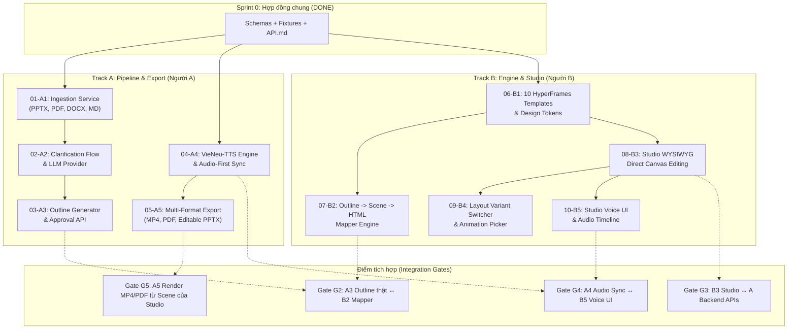

# AI Lecture Studio — Work Breakdown Tickets (Tracer Bullets)

> **Sprint 0 Frozen Contracts**: [schemas/](file:///c:/Users/OS/Downloads/project/my-presentation/schemas), [fixtures/](file:///c:/Users/OS/Downloads/project/my-presentation/fixtures), [docs/API.md](file:///c:/Users/OS/Downloads/project/my-presentation/docs/API.md).  
> **Rule**: Hai người làm việc song song trong worktree riêng. Chỉ giao tiếp qua shared contracts và mock fixtures.

---

## Dependency Graph (Sơ đồ phụ thuộc)

---

## Chi Tiết Các Tracer-Bullet Tickets

| ID | Thẻ | Tiêu đề | Phụ thuộc (Blocked by) | Trạng thái |
| :--- | :--- | :--- | :--- | :--- |
| **01** | `[A]` | Multi-format Document Ingestion Service | Không (Schema frozen) | `completed` |
| **02** | `[A]` | Clarification Interview & LLM Provider Setup | `01-A1` (Done) | `completed` |
| **03** | `[A]` | Pedagogical Outline Generator & Approval API | `02-A2` (Done) | `completed` |
| **04** | `[A]` | VieNeu-TTS Synthesis & Audio-First Sync Engine | Không (Done) | `completed` |
| **05** | `[A]` | Multi-format Export Jobs (MP4, PDF, PPTX) | `04-A4` (Done) | `completed` |
| **06** | `[B]` | Design Tokens & 10 HyperFrames Templates | Không (dùng `fixtures/scene.sample.json`) | `ready-for-agent` |
| **07** | `[B]` | Outline to Scene & HyperFrames Mapper | `06-B1` (dùng `fixtures/outline.sample.json`) | `pending` |
| **08** | `[B]` | Studio Canvas Direct Editing & Autosave | `06-B1` | `pending` |
| **09** | `[B]` | Layout Variant Switcher & Animation Picker | `08-B3` | `pending` |
| **10** | `[B]` | Studio Voice UI & Audio-Driven Timeline | `08-B3` | `pending` |
