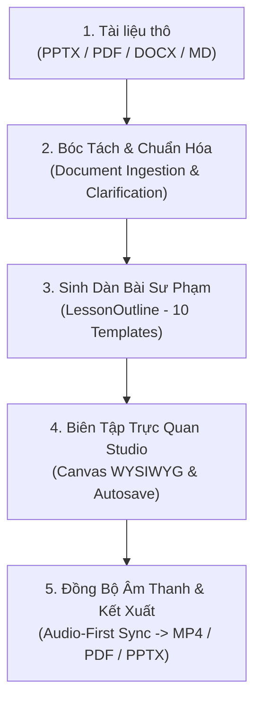

# AI Lecture Studio — Quy Trình Hoạt Động & Đặc Tả Kiểm Thử (QA Workflow Spec)

> **Tài liệu chuẩn cho QA / E2E Automation**: Dành cho QA Tester (Người hoặc AI Agent như `momentic-ai/skills@mo-qa`, Playwright Test Runner) thực hiện kiểm thử Black-box toàn diện trên giao diện Web Studio tại `http://localhost:3000` và API backend tại `http://localhost:8000`.  
> **Nguyên tắc cốt lõi**: QA chỉ kiểm thử theo kịch bản, ghi log, bắt lỗi và chụp ảnh màn hình — **TUYỆT ĐỐI KHÔNG SỬA MÃ NGUỒN**.

---

---

## 1. Giai đoạn 1: Tiếp Nhận Tài Liệu Thô (Raw Ingestion)
- **Mục tiêu**: Người dùng tải tài liệu giảng dạy gốc lên hệ thống qua nút bấm trên Web Studio.
- **Thành phần tham gia**:
  - Web UI: Nút `[📤 Tải tài liệu (.pptx / .pdf / .docx)]` (`#btn-upload-doc`), input `#input-doc-file`.
  - Backend API: `POST /projects` (Khởi tạo project), `POST /projects/{id}/documents` (Nhận file nhị phân).
  - Định dạng hỗ trợ: `.pptx`, `.pdf`, `.docx`, `.md` (Dung lượng tối đa: 50MB).
- **Quy trình kiểm thử (QA Steps)**:
  1. Truy cập `http://localhost:3000/`.
  2. Click nút `[📤 Tải tài liệu (.pptx / .pdf / .docx)]`.
  3. Chọn file hợp lệ (Ví dụ: file PPTX toán hoặc bài giảng triết học).
  4. Quan sát modal tiến trình `#upload-progress-modal` xuất hiện với icon `📁` và `📤`.
- **Tiêu chí chấp nhận (Pass Criteria)**:
  - API `POST /projects` trả về HTTP `201 Created` kèm `projectId`.
  - API `POST /projects/{id}/documents` trả về HTTP `200 OK` kèm JSON `DocumentContext`.
  - Toàn bộ văn bản, phân đoạn tiêu đề và hình ảnh trong file được bóc tách vào `storage/projects/{id}/`.

---

## 2. Giai đoạn 2: Bóc Tách & Chuẩn Hóa Sư Phạm (Clarification Interview)
- **Mục tiêu**: Hệ thống phỏng vấn người dùng các câu hỏi sư phạm cốt lõi trước khi AI tạo dàn ý.
- **Thành phần tham gia**:
  - Web UI: Pop-up `#clarification-modal` với 5 câu hỏi lựa chọn.
  - Backend API: `GET /projects/{id}/clarification`, `POST /projects/{id}/clarification`.
- **5 Câu hỏi chuẩn hóa**:
  1. **Đối tượng người học**: Sinh viên đại học năm 1 / Chuyên ngành nâng cao / Học sinh THPT / Người đi làm.
  2. **Thời lượng bài giảng**: 5 phút / 10 phút / 15 phút / 20 phút.
  3. **Số lượng slide**: 6 / 8 / 10 / 12 / 15 slides.
  4. **Câu hỏi trắc nghiệm (Check-in Quiz)**: Có / Không.
  5. **Giọng đọc thuyết minh (TTS)**: Mỹ Duyên (Nam Bộ) / Hà My (Bắc Bộ) / Ban Mai / Viettel.
- **Quy trình kiểm thử (QA Steps)**:
  1. Sau bước upload, modal `#clarification-modal` tự động bật lên.
  2. Kiểm tra tên tài liệu hiển thị tại `#clarification-doc-title`.
  3. Thử nghiệm 2 luồng:
     - **Luồng A**: Chọn các giá trị tùy biến rồi bấm `[🚀 Bắt đầu sinh bài giảng]` (`#btn-clarify-submit`).
     - **Luồng B**: Bấm trực tiếp `[Bỏ qua & Dùng mặc định]` (`#btn-clarify-skip`).
- **Tiêu chí chấp nhận (Pass Criteria)**:
  - Modal đóng lại mượt mà, gửi thành công payload lên `POST /projects/{id}/clarification` trả về HTTP `200 OK`.
  - File `storage/projects/{id}/clarification_answers.json` được tạo trên đĩa.

---

## 3. Giai đoạn 3: Sinh Dàn Bài Sư Phạm (LessonOutline)
- **Mục tiêu**: Gemini AI đọc `DocumentContext` và `clarification_answers.json` để sinh dàn bài chuẩn 10 Template HyperFrames.
- **Thành phần tham gia**:
  - Backend Module: `scripts/outline_generator.py`, `scripts/llm_provider.py` (Gemini Flash).
  - 10 Template ID bắt buộc: `title-slide`, `learning-objectives`, `concept-explain`, `bullet-breakdown`, `image-explain`, `comparison`, `timeline`, `formula-explain`, `quiz`, `summary`.
  - Backend API: `POST /projects/{id}/outline` (Sinh nháp), `PUT /projects/{id}/outline` (Phê duyệt).
- **Quy trình kiểm thử (QA Steps)**:
  1. Modal `#upload-progress-modal` hiển thị icon não bộ `🧠` với thanh tiến trình ~70%.
  2. Chờ API sinh dàn bài hoàn tất trong thời gian tối đa 15 giây.
  3. Hệ thống tự động gửi yêu cầu phê duyệt dàn bài (`status: approved`).
- **Tiêu chí chấp nhận (Pass Criteria)**:
  - `POST /projects/{id}/outline` trả về HTTP `200 OK`, JSON hợp lệ theo schema `LessonOutline`.
  - Mỗi slide có đầy đủ: `slideId`, `suggestedTemplateId` (thuộc 10 template), `keyTakeaways`, `speakerNotesDraft`.
  - Không xuất hiện lỗi `ValidationError` hoặc crash tiến trình.

---

## 4. Giai đoạn 4: Biên Tập Trực Quan Studio (Canvas WYSIWYG & Autosave)
- **Mục tiêu**: Slide HyperFrames Scene được sinh và nạp trực tiếp vào giao diện Studio Canvas 1920x1080 để giảng viên biên tập trực tiếp.
- **Thành phần tham gia**:
  - Giao diện: Canvas chính `#live-canvas`, Danh sách slide bên trái `#slide-list-container`, Bảng thuộc tính bên phải `#properties-sidebar`.
  - Script điều khiển: `index.html` (StudioApp), `studio/reducer.js`.
  - Backend API: `POST /projects/{id}/scene`, `GET /projects/{id}/scene`, `PUT /projects/{id}/scene` (Autosave).
- **Quy trình kiểm thử (QA Steps)**:
  1. Xác nhận modal đóng lại và toàn bộ danh sách slide hiển thị ở cột trái.
  2. Click vào từng slide trong danh sách: Canvas ở giữa phải render đúng bố cục và chữ của slide đó.
  3. **Chỉnh sửa trực tiếp (WYSIWYG)**:
     - Click chuột vào tiêu đề `.slide-title` trên Canvas và gõ thêm chữ.
     - Kiểm tra chỉ báo trạng thái `#save-status`: chuyển sang `● Đang lưu...` rồi `● Đã lưu` sau 500ms debounce.
  4. **Thay đổi Template & Layout Variant**:
     - Chọn template khác ở dropdown `#prop-template-select`.
     - Click các nút pill variant (`#variant-pills-container .variant-pill`).
     - Canvas phải thay đổi bố cục tương ứng ngay lập tức.
  5. **Undo / Redo**:
     - Nhấn `Ctrl + Z` hoặc bấm nút `#btn-undo`: nội dung quay về trạng thái trước.
     - Nhấn `Ctrl + Y` hoặc bấm nút `#btn-redo`: phục hồi nội dung vừa sửa.
- **Tiêu chí chấp nhận (Pass Criteria)**:
  - API `POST /projects/{id}/scene` trả về HTTP `201 Created`.
  - Mọi thao tác sửa đổi được tự động đồng bộ qua API `PUT /projects/{id}/scene` với phản hồi `{"status": "saved"}`.
  - Tải lại trang (F5): Dữ liệu vừa chỉnh sửa không bị mất.

---

## 5. Giai đoạn 5: Đồng Bộ Âm Thanh & Kết Xuất (Audio-First Sync & Multi-Export)
- **Mục tiêu**: Tạo giọng đọc thuyết minh tiếng Việt chuẩn cho từng slide, tự động co giãn timeline theo độ dài audio thực tế và kết xuất ra file MP4/PDF/PPTX.
- **Thành phần tham gia**:
  - Voice UI: Nút `[🎙️ Tạo Lại Giọng Đọc]` (`#btn-regen-voice`), Audio Player `#slide-audio-player`.
  - Engine TTS: `scripts/tts_provider.py` (VieNeu-TTS v3 Turbo / Viettel).
  - Đồng bộ Timeline: `scripts/audio_sync.py` (`sync_audio_first_timeline`).
  - Nút xuất file: `#btn-export-mp4`, `#btn-export-pdf`, `#btn-export-pptx`.
  - Backend API: `POST /projects/{id}/slides/{sid}/audio`, `POST /projects/{id}/export`, `GET /exports/{exportId}`.
- **Quy trình kiểm thử (QA Steps)**:
  1. Tại slide bất kỳ, kiểm tra ô kịch bản `#prop-narration-input`.
  2. Bấm nút `[🎙️ Tạo Lại Giọng Đọc]` (`#btn-regen-voice`).
  3. Quan sát nút đổi trạng thái sang `⏳ Đang tạo...` và chờ hoàn tất.
  4. Bấm Play trên trình phát `#slide-audio-player` để kiểm tra âm thanh phát ra.
  5. **Kiểm thử kết xuất**:
     - Click `[🎬 Xuất MP4]` (`#btn-export-mp4`).
     - Hộp thoại tiến trình kết xuất hiện ra, thanh progress chạy từ `0%` ➔ `100%`.
     - Sau khi hoàn tất, trình duyệt tự động mở link tải video MP4 hoặc file PDF/PPTX.
- **Tiêu chí chấp nhận (Pass Criteria)**:
  - API `POST /projects/{id}/slides/{sid}/audio` trả về HTTP `200 OK` kèm `durationSeconds` và `audioUrl`.
  - Thời lượng slide tự động điều chỉnh: `Slide Duration = Audio Duration + 1.0s`.
  - API `POST /projects/{id}/export` trả về HTTP `202 Accepted` kèm `exportId`.
  - Polling `GET /exports/{exportId}` hoàn thành với `status: completed` và `downloadUrl` hợp lệ.
