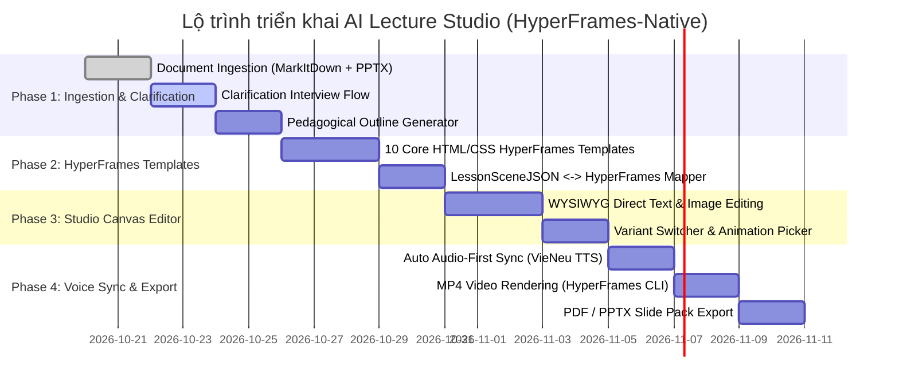

# AI Lecture Studio — Kế Hoạch Triển Khai MVP (HyperFrames-Native Plan)

> **Mục tiêu**: Xây dựng nền tảng hỗ trợ giảng viên chuyển đổi tài liệu bài giảng (PPTX, PDF, DOCX, Markdown) thành bài giảng tương tác theo chuẩn sư phạm, hỗ trợ chỉnh sửa trực quan (WYSIWYG Studio Canvas), thuyết minh tiếng Việt tự động (VieNeu TTS), và xuất video MP4 bài giảng sắc nét cùng PDF/PPTX.
> 
> **Quyết định kiến trúc cốt lõi**: Tích hợp trực tiếp **HyperFrames (HTML5 + CSS + GSAP)** làm Engine duy nhất cho cả Trình chiếu Slide, Studio Editor và Render Video MP4 (loại bỏ sự cồng kềnh của Presenton và Revideo).

---

## 1. Các Quyết Định Kiến Trúc Đã Thống Nhất (ADR Summary)

1. **Engine thống nhất (Unified HyperFrames Engine)**:
   - Thay vì dùng Presenton (slide) + Revideo (video), sử dụng **HyperFrames** làm engine chung.
   - Trình duyệt xem sao, Studio sửa y như vậy, và video MP4 render ra chuẩn xác 100% từng frame.
2. **Template & Schema**:
   - 10 Template sư phạm được xây dựng dưới dạng các component HTML/CSS/GSAP chuẩn HyperFrames.
   - Dữ liệu slide được điều khiển duy nhất qua **`LessonSceneJSON`**.
3. **Đồng bộ Voice-over (Auto Audio-First Sync)**:
   - Thời lượng audio phát thanh thực tế từ VieNeu-TTS / Viettel AI quyết định `durationSeconds` của slide.
   - Giảng viên sửa lời đọc $\rightarrow$ hệ thống tự sinh lại audio và tự động co giãn timeline GSAP tương ứng.
4. **Chiến lược Export MVP**:
   - **Ưu tiên số 1**: Xuất **MP4 Video** (qua `npx hyperframes render`) và **PDF** (chụp DOM vector qua Headless Chrome).
   - **PPTX**: Đóng gói nhanh dạng slide ảnh chất lượng cao để tiết kiệm thời gian phát triển MVP.
5. **Cấu trúc mã nguồn**:
   - Tiến hóa trực tiếp từ workspace hiện tại, kế thừa và chuẩn hóa các script đã kiểm chứng (`scripts/pptx_to_lecture.py`, `scripts/synthesize_slide.py`, `scripts/build_hyperframes.js`, `studio.html`, `server.js`).

---

## 2. Tech Stack Chuẩn Hóa

| Tầng | Công nghệ lựa chọn | Vai trò |
| :--- | :--- | :--- |
| **Presentation & Video Engine** | **HyperFrames (HTML5 + CSS + GSAP)** | Render slide, hiệu ứng động, timeline audio, xuất video MP4 |
| **Studio Canvas Editor** | **HTML5 ContentEditable + Vanilla JS / React** | Kéo thả, click-to-edit chữ, đổi ảnh trực quan (WYSIWYG) |
| **Backend & API** | **FastAPI / Node.js Express/Fastify** | REST API quản lý dự án, upload, orchestration |
| **Document Intelligence** | **MarkItDown + python-pptx** | Trích xuất cấu trúc văn bản, bảng biểu, hình ảnh, speaker notes |
| **AI Pedagogical Planner** | **Gemini Flash (Default) + Ollama Adapter** | Phỏng vấn làm rõ sư phạm & sinh `LessonOutline` |
| **Vietnamese TTS** | **VieNeu-TTS v3 Turbo / Viettel AI** | Tạo giọng đọc thuyết minh tiếng Việt tự nhiên từng slide |
| **Database & Storage** | **SQLite / PostgreSQL + Local Storage** | Lưu trữ project state, audio files và media assets |

---

## 3. Lộ Trình Triển Khai 4 Giai Đoạn (4-Phase Implementation)

---

## 4. Checklist Công Việc Chi Tiết

### Phase 1 — Ingestion & Pedagogical Clarification
- [ ] **1.1. Chuẩn hóa Service bóc tách tài liệu (Document Ingestion)**
  - [ ] Hoàn thiện `scripts/pptx_to_lecture.py` và tích hợp `MarkItDown` để đọc thêm PDF, DOCX, Markdown.
  - [ ] Bóc tách cấu trúc: Tiêu đề, các phần (sections), bullet points, ảnh nhúng, và speaker notes.
  - [ ] Chuẩn hóa output thành `DocumentContext.json`.
- [ ] **1.2. Pedagogical Clarification Interview**
  - [ ] Xây dựng bộ 8 câu hỏi làm rõ sư phạm (đối tượng học sinh, mục tiêu, thời lượng, số slide, phong cách, quiz).
  - [ ] Giao diện/Modal thu thập câu trả lời từ giảng viên.
- [ ] **1.3. Sinh và chỉnh sửa LessonOutline**
  - [ ] Prompt kỹ thuật cho Gemini Flash để sinh dàn bài sư phạm chuẩn (có learning objectives, quiz, summary).
  - [ ] API & Giao diện cho phép giảng viên duyệt/sửa dàn bài trước khi tạo slide.

### Phase 2 — Thư viện 10 Template HyperFrames & Mapper
- [ ] **2.1. Xây dựng 10 Template HTML/CSS/GSAP chuẩn HyperFrames**
  - [ ] `title-slide` — Slide mở đầu bài giảng (Tiêu đề, giảng viên, môn học).
  - [ ] `learning-objectives` — Mục tiêu bài học (3-4 bullet điểm nhấn).
  - [ ] `concept-explain` — Giải thích khái niệm (Text định nghĩa + hình minh họa).
  - [ ] `bullet-breakdown` — Phân tích luận điểm theo từng thẻ card.
  - [ ] `image-explain` — Tập trung vào sơ đồ/hình ảnh lớn kèm chú thích bên cạnh.
  - [ ] `comparison` — So sánh đối chiếu 2 cột (Ưu/Nhược, Đúng/Sai, Khái niệm A vs B).
  - [ ] `timeline` — Tiến trình lịch sử hoặc quy trình các bước thực hiện.
  - [ ] `formula-explain` — Công thức, định lý kèm giải thích các thành phần.
  - [ ] `quiz` — Câu hỏi kiểm tra hiểu bài dạng trắc nghiệm tương tác.
  - [ ] `summary` — Tổng kết toàn bộ bài học & lời dặn dò.
- [ ] **2.2. Generator Mapper (`outline_to_hyperframes.js`)**
  - [ ] Tự động map từ `LessonOutline` sang `LessonSceneJSON`.
  - [ ] Tự động sinh file `index.html` (root timeline của HyperFrames) gồm đầy đủ `.clip`, `data-start`, animation timeline.

### Phase 3 — Nâng cấp Studio Canvas Editor (WYSIWYG)
- [ ] **3.1. Chỉnh sửa nội dung trực tiếp (Direct On-Canvas Editing)**
  - [ ] Click trực tiếp vào văn bản để sửa (tiêu đề, nội dung, danh sách).
  - [ ] Click trực tiếp vào ảnh để mở modal chọn ảnh từ thư viện hoặc tải ảnh mới.
- [ ] **3.2. Bố cục linh hoạt (Layout Variant Switcher)**
  - [ ] Hỗ trợ chuyển đổi nhanh bố cục cho từng slide (Text trái - Ảnh phải, Text phải - Ảnh trái, Banner trên, Toàn màn hình, Không ảnh).
- [ ] **3.3. Bộ preset hiệu ứng (Animation Presets)**
  - [ ] Tích hợp bộ selector hiệu ứng: `fade-in`, `slide-in`, `zoom-in`, `typewriter`, `step-by-step`, `highlight-keyword`.
  - [ ] Lưu trạng thái vào `LessonSceneJSON` ngay khi giảng viên thao tác.

### Phase 4 — Voice Synthesis & Xuất bản (Export)
- [ ] **4.1. Tích hợp VieNeu-TTS v3 Turbo**
  - [ ] Tự động tạo câu thuyết minh (`narration`) cho từng slide từ nội dung và speaker notes.
  - [ ] Giảng viên nghe thử, sửa câu thuyết minh và bấm "Tạo lại giọng đọc".
- [ ] **4.2. Cơ chế Auto Audio-First Sync**
  - [ ] Đo độ dài thực tế của file audio tạo ra (`ffprobe` / Web Audio API).
  - [ ] Tự động cập nhật `durationSeconds` của slide và đẩy `data-start` của các slide tiếp theo.
- [ ] **4.3. Xuất file MP4 & PDF**
  - [ ] Tích hợp API gọi `npx hyperframes render` để kết xuất video MP4 bài giảng full HD 1080p có đầy đủ giọng đọc và hiệu ứng.
  - [ ] Tích hợp tính năng xuất PDF toàn bộ slide.
  - [ ] Đóng gói slide PPTX ảnh nhanh gọn.

---

## 5. Tiêu Chí Nghiệm Thu (Acceptance Criteria)

Sau khi hoàn thành:
1. Giảng viên tải lên 1 bài giảng mẫu (PPTX/PDF).
2. Hệ thống hỏi các câu sư phạm ngắn gọn $\rightarrow$ Sinh dàn bài bài giảng để giảng viên xác nhận.
3. Tự động sinh ra 8–12 slide chuẩn HyperFrames đẹp mắt với các template phù hợp nội dung.
4. Giảng viên vào Studio Canvas:
   - Click sửa trực tiếp văn bản, đổi ảnh, đổi bố cục.
   - Nghe thử giọng đọc tiếng Việt từng slide và sửa lời nếu cần.
5. Slide tự động căn chỉnh thời gian khớp chính xác với giọng đọc.
6. Bấm "Xuất Video" $\rightarrow$ Nhận file MP4 bài giảng hoàn chỉnh, âm thanh rõ nét, hiệu ứng chuyển động mượt mà.
